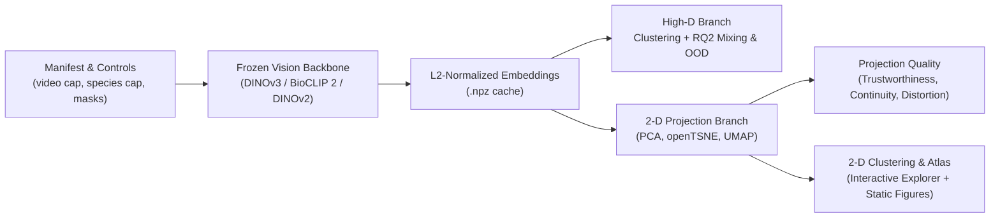
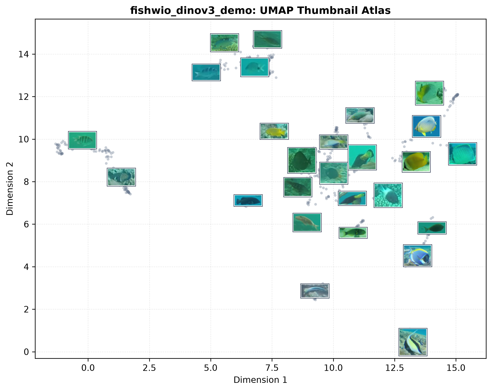
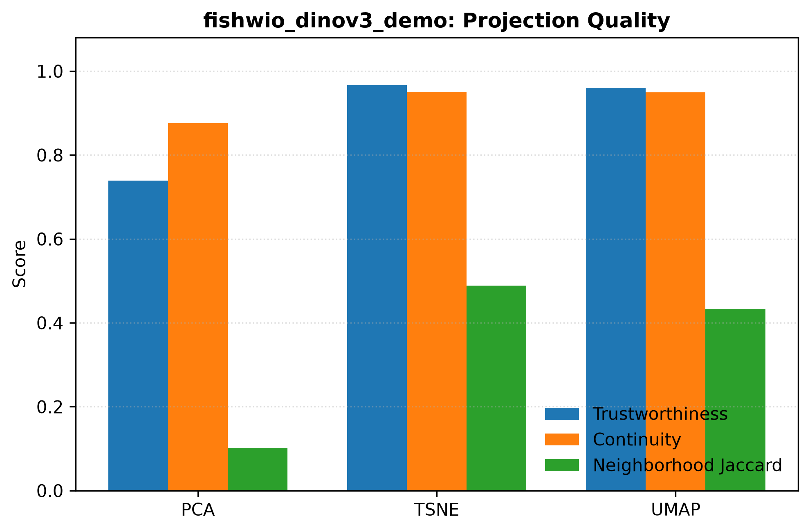
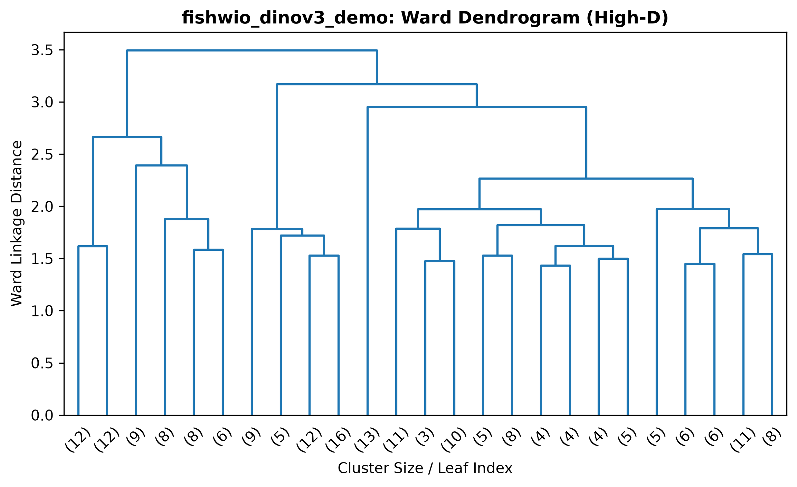
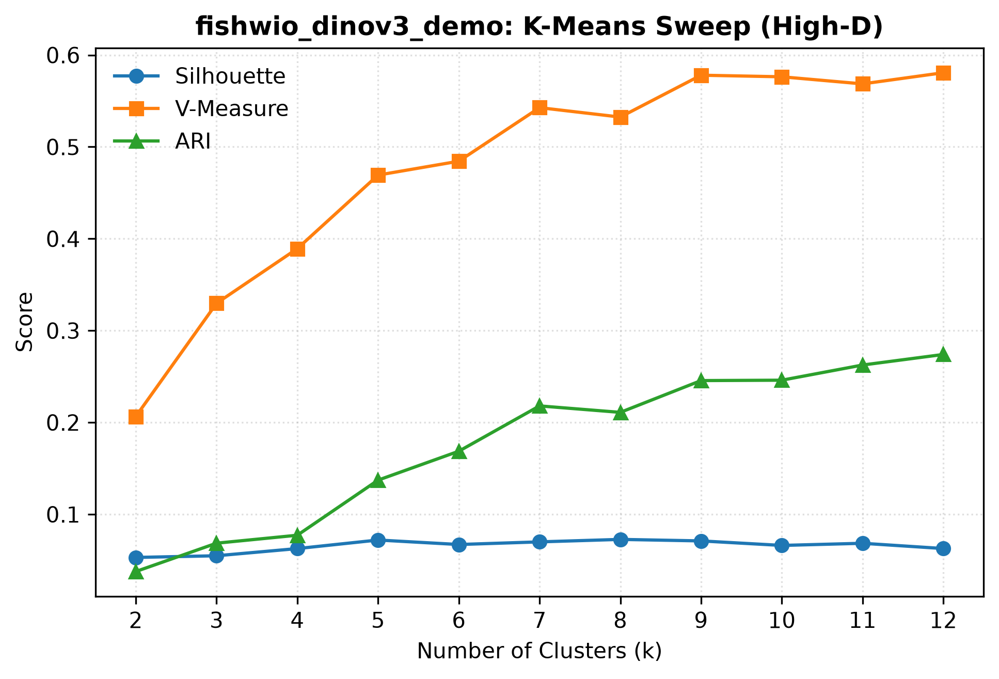
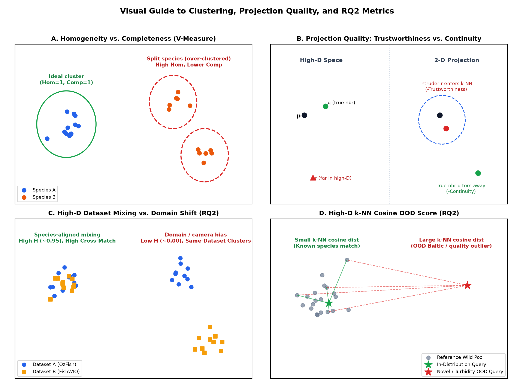

# Metrics and Methods Guide

This document explains every feature extraction, dimensionality reduction, clustering, and evaluation method implemented in `wild-fish-zeroshot-clustering`, together with visual examples generated from the codebase.

---

## 1. End-to-End Pipeline Architecture

The codebase separates **feature geometry in high dimensions** from **2-D projection geometry**, so clustering and domain-mixing claims can be checked in both spaces without trusting distorted 2-D plots blindly.

---

## 2. Methods Explained (with Visual Examples)

### 2.1 Frozen Feature Extractors & Pooling
*Implementation: [`src/fish_clustering/models/backbones.py`](../src/fish_clustering/models/backbones.py), [`src/fish_clustering/models/extractor.py`](../src/fish_clustering/models/extractor.py), [`src/fish_clustering/models/cache.py`](../src/fish_clustering/models/cache.py)*

All vision backbones run strictly frozen in evaluation mode (`torch.inference_mode()`, `requires_grad = False`), with no fine-tuning on fish labels:

| Backbone Key | Family / Backend | Model Checkpoint | Default Size | Notes |
| :--- | :--- | :--- | :---: | :--- |
| `dinov3_vitb16` | `timm` / HF fallback | `vit_base_patch16_dinov3.lvd1689m` / `facebook/dinov3-vitb16-pretrain-lvd1689m` | `224` | Primary compact self-supervised ViT (`768-D`) |
| `dinov3_vitl16` | `timm` / HF fallback | `vit_large_patch16_dinov3.lvd1689m` / `facebook/dinov3-vitl16-pretrain-lvd1689m` | `224` | Larger DINOv3 ViT-L/16 |
| `dinov3_vith16plus` | `timm` / HF fallback | `vit_huge_plus_patch16_dinov3.lvd1689m` / `facebook/dinov3-vith16plus-pretrain-lvd1689m` | `224` | Top capacity DINOv3 backbone matching Markoff et al. (2026) |
| `bioclip2_vitl14` | `open_clip` | `hf-hub:imageomics/bioclip-2` | `224` | Biology vision-language encoder (`cls` projection head) |
| `dinov2_vitb14` | `timm` | `vit_base_patch14_dinov2.lvd142m` | `224` | Baseline self-supervised ViT |
| `dinov2_vitl14` | `timm` | `vit_large_patch14_dinov2.lvd142m` | `224` | Larger DINOv2 baseline |

- **Token Pooling (`pooling`):**
  - `cls`: uses the global CLS/summary representation (`forward_head(..., pre_logits=True)` in `timm`, `pooler_output` or token `0` in HuggingFace `transformers`).
  - `patch_mean`: discards prefix CLS and register tokens (`num_prefix_tokens` in `timm`, `1 + num_register_tokens` in HuggingFace) and averages spatial patch tokens. Useful for testing whether pooling foreground patches reduces background bias.
- **L2 Normalization (`l2_normalize_embeddings`):** divides each embedding row by its Euclidean norm so cosine distance in high dimensions reduces cleanly to unit-sphere geometry.
- **Disk Cache (`extract_or_load_embeddings`):** caches embeddings as `.npz` files under `outputs/embeddings/` keyed by a SHA-256 hash of `(backbone, pooling, image_size, l2_normalize, use_foreground_mask, equalize_resolution, ordered_image_ids)`.

### 2.2 Methodological Sampling & Image Controls
*Implementation: [`src/fish_clustering/data/sampling.py`](../src/fish_clustering/data/sampling.py), [`src/fish_clustering/data/preprocessing.py`](../src/fish_clustering/data/preprocessing.py)*

- **Per-Video Near-Duplicate Cap (`cap_crops_per_video`):** limits crops taken from the same `(dataset, video_id)` group (stereo `OzFish` `_L`/`_R` cameras are grouped together by base deployment ID) so consecutive video frames do not inflate clustering purity or V-measure.
- **Per-Species Class Cap (`cap_images_per_species`):** bounds dominant species counts so majority species do not mask rare reef species.
- **Shared-Species Filter (`filter_shared_species`):** keeps only Latin binomial species appearing in at least `min_datasets` datasets for strict RQ2 cross-dataset evaluation.
- **Foreground Masking (`apply_foreground_mask`):** zeroes background pixels outside binary fish masks (supported on `FRGT`) to separate fish appearance from reef background cues.
- **Equalized Resolution (`equalize_resolution`):** resizes crops preserving aspect ratio and zero-pads to a square `(target_size, target_size)` canvas to test whether dataset separation comes from resolution differences rather than fish morphology.

### 2.3 Dimensionality Reduction (`PCA`, `openTSNE`, `UMAP`)
*Implementation: [`src/fish_clustering/clustering/reduction.py`](../src/fish_clustering/clustering/reduction.py)*

1. **PCA (`fit_pca`):** linear orthogonal baseline preserving global variance. Fast, deterministic, and useful as a sanity check showing what fails when linear projections collapse curved manifolds.
2. **openTSNE (`fit_tsne`):** uses `openTSNE.TSNE` with `metric="cosine"` and `initialization="pca"`. Unlike scikit-learn's `TSNE`, `openTSNE` returns a fitted `TSNEEmbedding` object supporting **out-of-sample projection** (`transform_new_points`), letting held-out `SCHUFI` or `HODOR` Baltic Sea crops be placed into a fixed open-ocean reference map without distorting reference clusters.
3. **UMAP (`fit_umap`):** constructs a fuzzy simplicial neighborhood graph (`metric="cosine"`, `umap_n_neighbors`, `umap_min_dist`) and supports `.transform()` for new points.

Below is an actual `UMAP` thumbnail atlas from our `FishWIO` + frozen `DINOv3 ViT-B/16` demo (`900` wild reef fish images across `30` species), followed by the corresponding projection-quality comparison across `PCA`, `t-SNE`, and `UMAP`:

### 2.4 Clustering Methods (`HDBSCAN`, `Ward`, `k-means`, `GMM`)
*Implementation: [`src/fish_clustering/clustering/algorithms.py`](../src/fish_clustering/clustering/algorithms.py)*

Because different clustering assumptions behave very differently on 2-D maps vs. 768-D embeddings, `run_clustering_suite` supports evaluating all four algorithms in both `high_dim` and 2-D spaces:

- **HDBSCAN (`cluster_hdbscan`):** density-based hierarchical clustering that discovers the number of clusters automatically and flags ambiguous points as `Noise (-1)`. Ideal when the true species count is unknown (`SCHUFI`/`FRGT`), though sensitive to sparse density in high dimensions.
- **Ward Agglomerative (`cluster_ward`):** bottom-up variance-minimizing hierarchical clustering (`linkage="ward"`). Strong on compact, unit-normalized DINOv3 species clusters.
- **k-means (`cluster_kmeans`):** spherical centroid partitioning (`n_init="auto"`).
- **GMM (`cluster_gmm`):** Gaussian Mixture Model with diagonal covariance (`covariance_type="diag"`, `reg_covar=1e-5`) to stay tractable on 768-D to 1280-D embeddings.

When `n_clusters=None`, `run_clustering_suite` runs `hdbscan` first and passes its discovered cluster count (`>= 2`) to `ward`, `kmeans`, and `gmm`. Static diagnostic plots summarize cluster hierarchy (`plot_ward_dendrogram`) and cluster count sensitivity (`plot_k_sweep`):

| Ward Hierarchical Structure | K-Means Sweep (`k` Sensitivity) |
| :---: | :---: |
|  |  |

---

## 3. Evaluation Metrics Reference

### Quick-Reference Table

| Metric | Category | Range | Better | Space Evaluated | Source Function |
| :--- | :--- | :---: | :---: | :--- | :--- |
| `homogeneity` | RQ1 Supervised | `[0, 1]` | Higher (`1.0`) | High-D & 2-D | `compute_supervised_clustering_metrics` |
| `completeness` | RQ1 Supervised | `[0, 1]` | Higher (`1.0`) | High-D & 2-D | `compute_supervised_clustering_metrics` |
| `v_measure` | RQ1 Supervised | `[0, 1]` | Higher (`1.0`) | High-D & 2-D | `compute_supervised_clustering_metrics` |
| `ari` | RQ1 Supervised | `[-1, 1]` | Higher (`1.0`) | High-D & 2-D | `compute_supervised_clustering_metrics` |
| `ami` | RQ1 Supervised | `[~0, 1]` | Higher (`1.0`) | High-D & 2-D | `compute_supervised_clustering_metrics` |
| `noise_fraction` | Density Diag. | `[0, 1]` | Context-dependent | High-D & 2-D | `compute_supervised_clustering_metrics` |
| `silhouette` | Label-Free | `[-1, 1]` | Higher (`1.0`) | High-D & 2-D | `compute_label_free_metrics` |
| `calinski_harabasz` | Label-Free | `[0, inf)` | Higher | High-D & 2-D | `compute_label_free_metrics` |
| `davies_bouldin` | Label-Free | `[0, inf)` | **Lower (`0.0`)** | High-D & 2-D | `compute_label_free_metrics` |
| `dbcv` | Label-Free | `[-1, 1]` | Higher (`1.0`) | `<= 10-D` only | `compute_label_free_metrics` |
| `trustworthiness` | OVGU Proj. | `[0, 1]` | Higher (`1.0`) | High-D vs. 2-D | `compute_trustworthiness` |
| `continuity` | OVGU Proj. | `[0, 1]` | Higher (`1.0`) | High-D vs. 2-D | `compute_continuity` |
| `per_point_distortion` | OVGU Proj. | `[0, 1]` | **Lower (`0.0`)** | Per sample | `compute_pointwise_distortion` |
| `mean_normalized_entropy` | RQ2 Mixing | `[0, 1]` | Higher (if mixed) | Strictly High-D | `compute_dataset_mixing_entropy` |
| `mean_same_dataset_rate` | RQ2 Mixing | `[0, 1]` | Lower (`~1/D` ideal) | Strictly High-D | `compute_dataset_mixing_entropy` |
| `top1_cross_dataset_accuracy` | RQ2 Species | `[0, 1]` | Higher (`1.0`) | Strictly High-D | `compute_cross_dataset_species_match` |
| `knn_cross_dataset_precision` | RQ2 Species | `[0, 1]` | Higher (`1.0`) | Strictly High-D | `compute_cross_dataset_species_match` |
| `ood_score` | RQ2 Novelty | `[0, 2]` (cosine) | Low=In, High=OOD | Strictly High-D | `compute_knn_ood_scores` / `compute_self_knn_ood_scores` |

---

### 3.1 Supervised Clustering Metrics (RQ1)
*Source: [`src/fish_clustering/evaluation/clustering_metrics.py`](../src/fish_clustering/evaluation/clustering_metrics.py)*

Missing/blank ground-truth entries (`None`, `NaN`, or empty string) are filtered automatically before scoring.

- **Homogeneity ($h$)**: Measures whether every predicted cluster contains samples from only a single true species. Splitting one species into two pure clusters keeps $h = 1.0$.
- **Completeness ($c$)**: Measures whether all samples of a true species are placed into the same cluster. Splitting a species lowers $c$ (see Panel A above).
- **V-Measure ($V$)**: Harmonic mean of Homogeneity and Completeness:
  $$V = \frac{2 \cdot h \cdot c}{h + c}$$
  Matches Markoff et al. (2026) when comparing across datasets with varying cluster counts.
- **Adjusted Rand Index ($\text{ARI}$):** Pairwise agreement between true species and predicted clusters, corrected for chance grouping ($\text{ARI} = 1.0$ is exact recovery, $0.0$ is random assignment). With many fine-grained classes (for instance `95` species in `FishWIO`), over-splitting a few species drops `ARI` faster than `V-Measure`.
- **Adjusted Mutual Information ($\text{AMI}$):** Information-theoretic agreement corrected for chance when cluster counts vary widely across species.
- **Noise Fraction:** Fraction of labeled samples assigned `-1` by density clusterers like `HDBSCAN`. Very high noise fraction (> `0.8`) in `high_dim` indicates Euclidean/cosine density thresholds are too strict for that embedding dimension.

### 3.2 Label-Free Clustering Metrics
*Source: [`src/fish_clustering/evaluation/clustering_metrics.py`](../src/fish_clustering/evaluation/clustering_metrics.py)*

Evaluated over non-noise clusters (`labels != -1`) when at least 2 clusters exist (`NaN` otherwise):

- **Silhouette Score:** Mean normalized difference between nearest-cluster separation ($b_i$) and intra-cluster cohesion ($a_i$):
  $$s_i = \frac{b_i - a_i}{\max(a_i, b_i)}$$
  Helpful for comparing 2-D cluster tightness, though biased toward convex spherical clusters.
- **Calinski-Harabasz Index:** Ratio of between-cluster dispersion to within-cluster dispersion (higher = tighter, better-separated spherical clusters).
- **Davies-Bouldin Index:** Average similarity ratio of each cluster with its most similar neighbor cluster (**lower is better**).
- **DBCV (Density-Based Clustering Validation):** Evaluates arbitrary-shaped density clusters without assuming spherical shapes, penalizing empty voids or noise misclassification. Following literature guidelines, `compute_label_free_metrics` enables `dbcv` only when `features.shape[1] <= 10` (`max_dbcv_dim=10`) because MST density estimates break down in `768-D+` spaces (`dbcv = NaN` in `high_dim`).

### 3.3 Projection Quality Metrics (OVGU Visualization Validation)
*Source: [`src/fish_clustering/evaluation/projection_metrics.py`](../src/fish_clustering/evaluation/projection_metrics.py)*

Before interpreting clusters inside a 2-D `PCA`, `openTSNE`, or `UMAP` scatter plot, these metrics verify how faithfully the 2-D layout preserves original high-D neighborhoods (Panel B):

- **Trustworthiness ($T(k)$):** Penalizes **false intrusions**, i.e., points far apart in high-D (`cosine`) that get pulled into a point's $k$ nearest neighbors in 2-D:
  $$T(k) = 1 - \frac{2}{n k (2n - 3k - 1)} \sum_{i=1}^{n} \sum_{j \in V_k(i) \setminus U_k(i)} \big(r_{\text{high}}(i, j) - k\big)$$
  where $U_k(i)$ is the high-D $k$-NN set and $V_k(i)$ is the low-D $k$-NN set.
- **Continuity ($C(k)$):** Venna & Kaski (2006) dual metric implemented via memory-safe chunked distance computation (`compute_continuity`). Penalizes **tears**, i.e., true high-D neighbors pushed far away in 2-D:
  $$C(k) = 1 - \frac{2}{n k (2n - 3k - 1)} \sum_{i=1}^{n} \sum_{j \in U_k(i) \setminus V_k(i)} \big(r_{\text{low}}(i, j) - k\big)$$
- **Per-Point Neighborhood Jaccard Distortion:** Used to color every dot in the interactive atlas's **Projection Distortion** view:
  $$\text{distortion}_i = 1 - \frac{|U_k(i) \cap V_k(i)|}{|U_k(i) \cup V_k(i)|} \in [0, 1]$$
  Points near `1.0` should not be interpreted by 2-D proximity alone; inspect their **Top-5 High-D Nearest Neighbors** in the side panel instead.

### 3.4 RQ2 Dataset Mixing, Cross-Dataset Matching, and OOD Metrics
*Source: [`src/fish_clustering/evaluation/rq2_metrics.py`](../src/fish_clustering/evaluation/rq2_metrics.py)*

All RQ2 metrics operate **directly on the L2-normalized high-D embeddings** (`metric="cosine"`):

- **Normalized Dataset Mixing Entropy (`compute_dataset_mixing_entropy`):**
  For each sample $i$, take its $k$ high-D nearest neighbors across the merged dataset pool and compute the empirical dataset distribution $p_{i,d}$ across $D$ datasets:
  $$H_i = \frac{-\sum_{d=1}^{D} p_{i,d} \ln p_{i,d}}{\ln D} \in [0, 1]$$
  Values near `1.0` mean datasets mix locally; values near `0.0` mean each dataset sits in an isolated pocket (Panel C). Note: high mixing entropy is desirable **specifically on shared species**, whereas unique/endemic species should separate from unrelated ones.
- **Same-Dataset Neighbor Rate (`mean_same_dataset_rate`):** Average fraction of a point's $k$ nearest neighbors that belong to the same dataset. Values near `1.0` when species overlap indicate strong domain/camera shift.
- **Cross-Dataset Shared-Species Match (`compute_cross_dataset_species_match`):**
  Evaluates **only** species occurring in `>= 2` datasets. For each sample in dataset $d$, queries nearest neighbors strictly in other datasets ($d' \neq d$) and computes:
  - `top1_cross_dataset_accuracy`: fraction whose closest neighbor from another dataset has the exact same Latin binomial species.
  - `knn_cross_dataset_precision`: average fraction of its $k$ cross-dataset neighbors with the exact same species.
  This directly answers RQ2: do frozen ViTs retrieve the **same fish species** across completely different underwater cameras?
- **High-D k-NN Cosine OOD Score (`compute_knn_ood_scores`, `compute_self_knn_ood_scores`):**
  Mean cosine distance (`1 - cos_sim`, range `[0, 2]`) to the $k$ nearest neighbors in the reference wild pool (or leave-one-out within the dataset). High OOD distance highlights either novel local species (`SCHUFI` / `HODOR` Baltic fish absent from tropical training pools) or severe visual degradation such as turbidity, motion blur, or partial crops (Panel D).

---

## 4. Real Walkthrough: `FishWIO` with Frozen `DINOv3 ViT-B/16`

Running [`configs/fishwio_dinov3_demo.yaml`](../configs/fishwio_dinov3_demo.yaml) (`900` wild reef fish images across `30` species, `20-30` images per species, `max_crops_per_video: 5` per species, `768-D` `facebook/dinov3-vitb16-pretrain-lvd1689m`, `cls` pooling) illustrates how all metric groups behave together:

1. **Projection Quality (`projection_metrics.csv`):**
   - `t-SNE` (`Trust=0.967`, `Cont=0.950`, `Jaccard=0.488`) and `UMAP` (`Trust=0.960`, `Cont=0.950`, `Jaccard=0.433`) strongly outperform linear `PCA` (`Trust=0.739`, `Cont=0.876`, `Jaccard=0.102`).
2. **High-D vs. 2-D Clustering (`clustering_metrics.csv`):**
   - With `20-30` samples per species, `UMAP HDBSCAN` automatically discovers `31` clusters out of `30` species (`V-Measure = 0.837`, `Homogeneity = 0.835`, `Completeness = 0.840`, `ARI = 0.646`, `AMI = 0.805`, `DBCV = 0.643`), and `t-SNE HDBSCAN` discovers `22` clusters (`V-Measure = 0.776`, `AMI = 0.744`).
   - Fixed-`k` methods peak on `UMAP Ward` (`V-Measure = 0.870`, `ARI = 0.747`, `AMI = 0.846`, `Silhouette = 0.670`), `UMAP k-means` (`V-Measure = 0.866`, `ARI = 0.742`), and `High-D Ward` (`V-Measure = 0.809`, `ARI = 0.600`, `AMI = 0.773`), whereas `PCA Ward` lags behind (`V-Measure = 0.438`, `ARI = 0.130`).
   - Notice `High-D HDBSCAN` (`min_cluster_size=10`) still marks `61.8%` of 768-D embeddings as noise (`V-Measure = 0.319`), confirming why Markoff et al. (2026) and this thesis compare density clustering on low-D `t-SNE`/`UMAP` embeddings against hierarchical clustering (`Ward`) in high dimensions.
